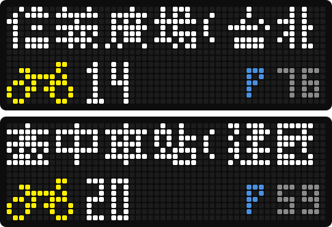

# AWTRIX YouBike Stations TW

[繁體中文](README.zh-TW.md)

Glance at your clock before you head out and see whether the YouBike stations near you have bikes. A Berry app for AWTRIX clocks running the [awtrix-ng](https://blueforcer.github.io/awtrix-ng/) firmware (52×16, e.g. Ulanzi TC002). The clock asks YouBike directly, so no server or proxy is needed, and station names are shown in Chinese with a built-in 8 px pixel font.

**Install: https://awtrix.de/script/KtaA0XnhWNap · Pick your stations: https://patw0929.github.io/awtrix-youbike/**



Unofficial. Not affiliated with YouBike Co., Ltd.

## What it shows

- **Top row:** the station name in Chinese. Names longer than 6 characters scroll, and the page stays until the name has scrolled through
- **Bottom row:** a yellow bike, bikes to rent (white; orange when fewer than your threshold; red at zero), a yellow bolt with the number of e-bikes (YouBike 2.0E), and a blue **P** with free docks
- **Right edge:** which station you are on; it turns red when the last update failed
- The bike rides while the numbers are being updated
- Status messages: 載入中 (loading), 查無此站 (unknown station), 暫停營運 (station paused), 連線失敗 (connection failed), 請設定站點 (no stations set)

## Controls

| Action | Effect |
| --- | --- |
| Press the knob or the middle button | Refresh now |
| Turn the knob | Next / previous station |
| The app comes back on screen | Refreshes if the numbers are older than 1 minute |

## Setup

1. Install **[YouBike Stations TW](https://awtrix.de/script/KtaA0XnhWNap)** from the AWTRIX Hub (press **Send to AWTRIX** on that page), or with the command below
2. Open the [station picker](https://patw0929.github.io/awtrix-youbike/), search by name or tap **📍 附近** (nearby), and add up to 8 stations. You can rename and reorder them, and open each one on Google Maps
3. Copy the result and paste it into the app's **Stations 站點** setting in the clock's web page. On the same network you can also press **寫入 AWTRIX 終端** to write it straight to the clock

The setting is a comma separated list of `station number:display name`, for example `500101001:捷運科技大樓站,500101274:科技大樓2號出口`. Without a name the last 4 digits of the number are shown.

| Setting | Default | |
| --- | --- | --- |
| Stations 站點 | | Up to 8 stations |
| Refresh 更新間隔 | 2 min | How often the clock asks YouBike |
| Seconds per station 每站秒數 | 5 s | Long names stay until they have scrolled through |
| Few bikes 車少門檻 | 3 | The count turns orange below this, red at zero |
| Show e-bikes 顯示電輔車 | on | Bolt and e-bike count |

## Install without the hub

```bash
curl -X PUT -H "Content-Type: text/plain" --data-binary @app/youbike.be http://192.168.1.100/api/v1/apps/script/YouBike-Stations-TW
```

## Development

| Path | |
| --- | --- |
| `app/youbike.src.be` | App source. **Edit this one** |
| `app/youbike.be` | Built app: the source plus the font subset. This is what goes on the clock |
| `scripts/build.py` | Picks the characters used in all YouBike station names and builds `app/youbike.be` and `picker/chars.js` |
| `assets/cjk_font.bin` | Fusion Pixel 8 px glyphs (2 bytes code point + 7 rows each) |
| `picker/` | The station picker (static page, published with GitHub Pages) |
| `youbike.py` | Command line helper: `find`, `check`, `install`, `set`, `refresh` |
| `scripts/mockups.py` | Draws layout mockups as SVG |

```bash
python3 scripts/build.py --check
```

```bash
python3 scripts/build.py --write
```

```bash
python3 youbike.py check "500101001:Home,500101274:MRT"
```

`install`, `set` and `refresh` only print what they would do; add `--yes` to write to the clock.

The font subset covers the 1,531 characters used in YouBike station names across Taiwan plus common words for custom names (about 14 KB). A character outside the subset shows as a box; the picker warns about these.

## Data

- Live numbers: `POST https://apis.youbike.com.tw/tw2/parkingInfo` with `{"station_no": [...]}`. It returns only the stations asked for and works for every city. `status` other than 1 means the station is paused; unknown numbers are left out
- Station list (picker only): `https://apis.youbike.com.tw/json/station-min-yb2.json`, about 4.2 MB, too big for the clock
- These are the endpoints the YouBike website uses, not a documented public API, so they may change

## License

- Code: [MIT](LICENSE)
- Glyphs: [Fusion Pixel Font](https://github.com/TakWolf/fusion-pixel-font) by TakWolf, SIL Open Font License 1.1
