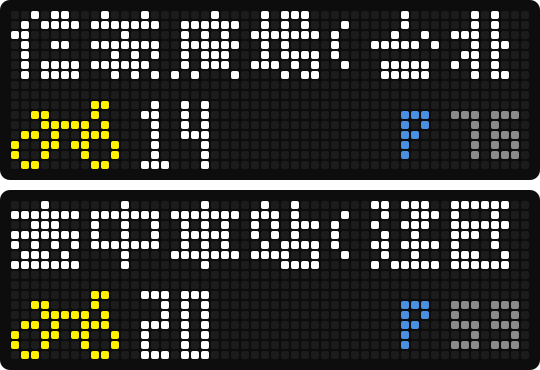

# AWTRIX YouBike Stations TW

[English](README.md)

出門前瞄一眼時鐘，就知道附近幾個 YouBike 站有沒有車可借。給 [awtrix-ng](https://blueforcer.github.io/awtrix-ng/) 韌體（52×16，例如 Ulanzi TC002）的 Berry app：時鐘直接向 YouBike 官網查詢，不需要中繼伺服器；中文站名用內嵌的 8px 點陣字顯示。

**選站網頁：https://patw0929.github.io/awtrix-youbike/**



非官方工具，與 YouBike 公司無關。

## 畫面

- 上排：中文站名（超過 6 字會捲動，捲完才換下一站）
- 下排：黃色腳踏車、可借車數（白；少於門檻橘；沒車紅）、黃色閃電＋電輔車數、藍 P＋可還空位
- 右緣細條：第幾站；變紅表示上次更新失敗
- 更新中腳踏車會「騎動」
- 狀態：載入中、查無此站、暫停營運、連線失敗、請設定站點

## 操作

| 動作 | 效果 |
| --- | --- |
| 旋鈕按下／中間鍵 | 強制更新 |
| 旋鈕左右 | 上一站／下一站 |
| 切回這個 app | 資料超過 1 分鐘就自動重抓 |

## 設定

1. 在 AWTRIX 終端安裝 **YouBike Stations TW**（從 AWTRIX script hub，或用下方指令）
2. 打開[選站網頁](https://patw0929.github.io/awtrix-youbike/)：輸入站名或按「📍 附近」→ 按＋加入（最多 8 站，可改顯示名稱、排序，也能開 Google Maps 確認位置）
3. 複製設定，貼到 AWTRIX 終端網頁裡這個 app 的 **Stations 站點** 欄位。同網路下也可以直接按「寫入 AWTRIX 終端」

設定格式：`站點代號:顯示名稱`，逗號分隔，例如 `500101001:捷運科技大樓站,500101274:科技大樓2號出口`。沒寫名稱就顯示代號末 4 碼。

| 設定 | 預設 | |
| --- | --- | --- |
| Stations 站點 | | 最多 8 站 |
| Refresh 更新間隔 | 2 分鐘 | 多久向 YouBike 查一次 |
| Seconds per station 每站秒數 | 5 秒 | 長站名會停到捲完 |
| Few bikes 車少門檻 | 3 | 少於這個數變橘色，0 台變紅色 |
| Show e-bikes 顯示電輔車 | 開 | 閃電與電輔車數 |

## 不透過 hub 安裝

```bash
curl -X PUT -H "Content-Type: text/plain" --data-binary @app/youbike.be http://192.168.1.100/api/v1/apps/script/YouBike-Stations-TW
```

## 開發

| 檔案 | 用途 |
| --- | --- |
| `app/youbike.src.be` | app 原始碼（**改這份**） |
| `app/youbike.be` | 產物：原始碼＋字型子集，裝到時鐘的是這份 |
| `scripts/build.py` | 從全台站名挑出要用的字，產生 `app/youbike.be` 與 `picker/chars.js` |
| `assets/cjk_font.bin` | Fusion Pixel 8px 點陣字（每字 2 bytes 碼位＋7 列） |
| `picker/` | 選站網頁（靜態，用 GitHub Pages 發布） |
| `youbike.py` | 電腦端工具：find／check／install／set／refresh |
| `scripts/mockups.py` | 畫版面示意 SVG |

```bash
python3 scripts/build.py --check
```

```bash
python3 scripts/build.py --write
```

```bash
python3 youbike.py check "500101001:Home,500101274:MRT"
```

`install`、`set`、`refresh` 預設只檢查，加 `--yes` 才寫入時鐘。

字型子集涵蓋全台 YouBike 站名用到的 1531 字，加上介面用字與自訂名稱常用字（約 14 KB）。子集以外的字會顯示成方框，選站網頁會提醒。

## 資料來源

- 即時：`POST https://apis.youbike.com.tw/tw2/parkingInfo`，body `{"station_no":[...]}`，只回指定站點，全台適用；`status` 不是 1 表示暫停；查不到的代號會被略過
- 站點清單（只有選站網頁用）：`https://apis.youbike.com.tw/json/station-min-yb2.json`，約 4.2 MB，時鐘下載不了
- 這些是 YouBike 官網使用的端點，不是正式公開 API，格式可能改變

## 時鐘 API 備忘（awtrix-ng，實機確認）

- `PUT apps/script/<名稱>`：安裝／更新 app，設定會保留
- `PATCH apps/<名稱>/config`：改設定欄位（寫到 `/data` 會回 422）
- `PATCH apps/<名稱>/data`：寫非設定的資料，app 會重新載入
- `PUT apps/active` body `{"name": "<名稱>"}`：切到該 app
- `GET display/screen`：讀 52×16 畫素
- 時鐘 API 有開 CORS（含 Private Network）

## 授權

- 程式：[MIT](LICENSE)
- 點陣字：[Fusion Pixel Font](https://github.com/TakWolf/fusion-pixel-font)（TakWolf，SIL OFL 1.1）
